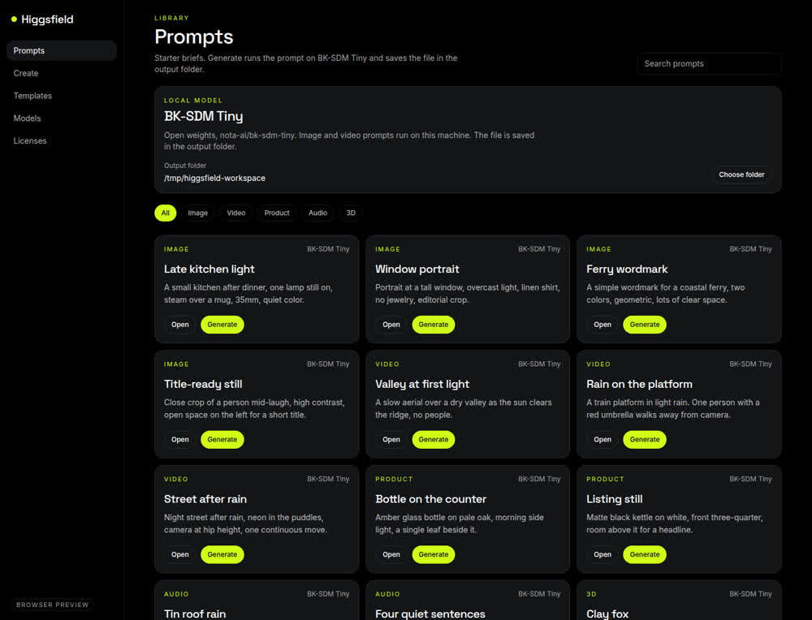
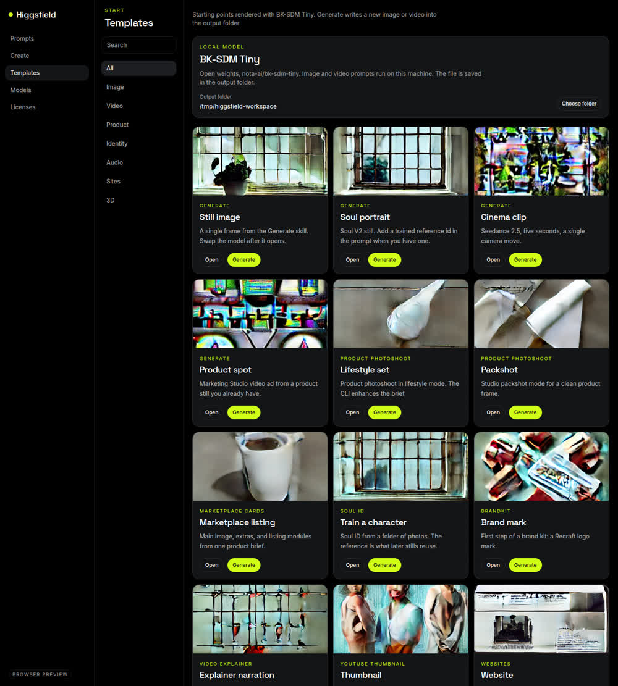
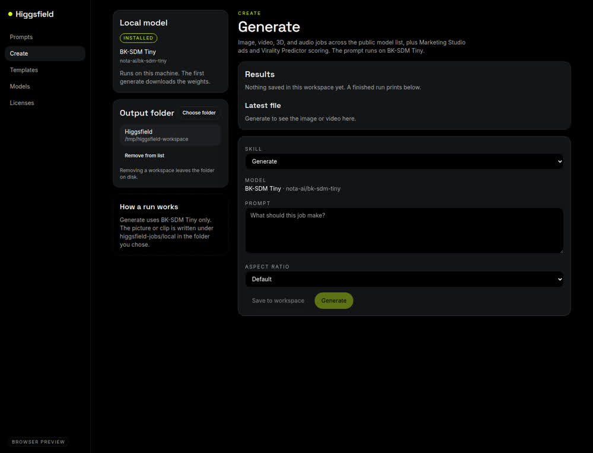

# Higgsfield for Mac

Open source Mac app for [Higgsfield](https://higgsfield.ai) prompts and templates. Image and video generation runs on this machine.

The window is a black studio with a lime accent. First open asks for a starter template. Create takes a prompt and an open checkpoint, shows download progress, and saves the file in `~/Pictures/Higgsfield`.

[REA](https://github.com/morluto/rea) (`rea-agents`) inspects local safetensors headers. It does not load weights or run the picture. Hosted Higgsfield names — Soul, Kling, Veo, Seedance, Genjutsu — stay in the library and are not downloads.

## Screenshots







## Local model

Local stills use an open checkpoint in the model folders. **SDXL Base** (`stabilityai/stable-diffusion-xl-base-1.0`, `sd_xl_base_1.0.safetensors`) is the full checkpoint. **SD Turbo** and **SDXL Turbo** are distilled fast models, not the quality checkpoint. See [NOTICES.md](NOTICES.md). They are not Soul, Kling, Veo, Seedance, or Genjutsu.

- Generate saves a PNG from the checkpoint you select. A `.safetensors` or `.ckpt` already in `checkpoints`, `diffusion_models`, or the other local folders can be selected too.
- A local clip saves an MP4 made of stills from that same checkpoint. The file is labeled as that, not as a hosted video model.
- If the selected open checkpoint is missing, Generate writes a staged `.part`, shows percent, transferred size, speed, and time remaining in Downloads, then commits the file.
- REA inspects the unet safetensors header after the file is on disk. If `rea` is not installed, inspection is unavailable and the app does not invent tensor metadata.
- Files are saved in `~/Pictures/Higgsfield`. The app never uses `/`.

Template cards ship with a demo generated from each template prompt. Those files are packed into the app next to the window.

## Install the app

A disk image for this studio is published only after Generate writes a real image and GitHub Actions `hdiutil verify` passes. Older images, including 0.1.4, are the previous runner.

There is no Apple Developer ID. The app is ad-hoc signed, and it is not notarized. A browser attaches a quarantine flag. macOS then says “Higgsfield” is damaged, and right-click Open does not get past that dialog. The disk image also contains `Open Higgsfield.command`. macOS blocks that file (“Open Higgsfield.command” Not Opened. Apple could not verify it is free of malware), so the file never runs and never clears quarantine.

Open the disk image so the volume `Higgsfield` is mounted. The volume is read-only, so copy the app into Applications and clear the flag in Terminal. The `xattr` on your PATH is not the system command. It rejected `-r`. These commands call `/usr/bin/xattr`:

```bash
/usr/bin/ditto "/Volumes/Higgsfield/Higgsfield.app" /Applications/Higgsfield.app
/usr/bin/xattr -cr /Applications/Higgsfield.app
/usr/bin/open /Applications/Higgsfield.app
```

If `/Applications` is not writable, use `$HOME/Applications` in all three commands.

The disk image is created with `hdiutil` and checked with `hdiutil verify` before it is published. The app is ad-hoc signed and not notarized.

## Develop

Install [Node.js 22](https://nodejs.org/) and Python 3.12, then:

```bash
npm install
python3 -m venv runner/.venv
runner/.venv/bin/pip install -r runner/requirements.txt
npm run dev
```

That starts the Electron window and the renderer at <http://127.0.0.1:43127>.

`npm run dev:web` serves the screens without a window. Choosing a folder uses the system dialog in the Electron window.

## Checks

```bash
npm test
npm run typecheck
```

## Build a disk image

On a Mac:

```bash
npm run dist:mac
```

`npm run dist:mac` writes `release/<version>/Higgsfield-<version>-<arch>.dmg`. electron-builder does not use a Developer ID (`identity` is null). `scripts/adhoc-sign.mjs` then ad-hoc signs the bundle, and the disk image must pass `codesign --verify --deep --strict` and `hdiutil verify`. The image also contains `Open Higgsfield.command`. macOS blocks that file before it can run, so the install steps above clear quarantine with `/usr/bin/xattr -cr` in Terminal. The app is not notarized. GitHub Actions on `macos-latest` builds the disk image for a `v*` tag, or for a `main` commit whose message contains `Release v`, and attaches the `.dmg` to the GitHub Release.

## What you can do

- Pick a starter, then a template. Hosted apps stay labeled as having no public weights.
- Generate a still or a local clip on this machine. The result is shown in the window and saved in Pictures/Higgsfield.

## License

MIT. See [LICENSE](LICENSE), [NOTICES.md](NOTICES.md), [CONTRIBUTING.md](CONTRIBUTING.md), and [SECURITY.md](SECURITY.md).
